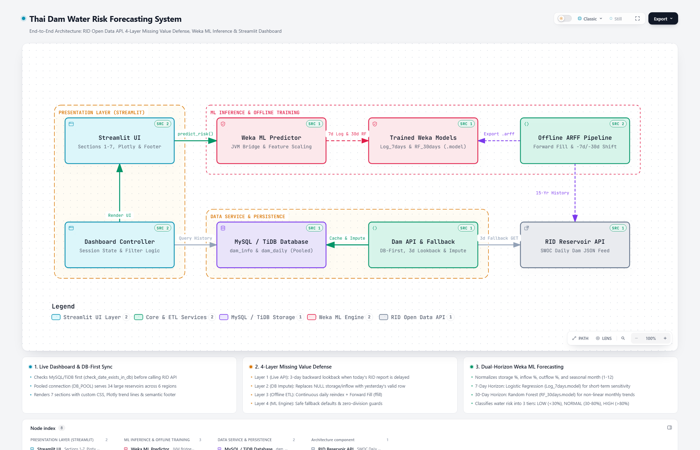

<div align="center">

# [Thai Dam Forecast](https://thai-dam-classification-project.streamlit.app/)

**ระบบพยากรณ์ความเสี่ยงน้ำของอ่างเก็บน้ำ 35 แห่ง ในสังกัดกรมชลประทาน**

ใช้ Machine Learning (Weka) พยากรณ์สถานการณ์น้ำล่วงหน้า 7 และ 30 วัน
ผ่าน Web Dashboard ด้วย **Streamlit** - ดึงข้อมูลจริงจาก RID API อัตโนมัติ


</div>

---

## สารบัญ

- [ฟีเจอร์หลัก](#ฟีเจอร์หลัก)
- [โครงสร้างหน้า Dashboard (7 Sections)](#โครงสร้างหน้า-dashboard-7-sections)
- [สถาปัตยกรรม](#สถาปัตยกรรม)
- [โครงสร้างโปรเจค](#โครงสร้างโปรเจค)
- [การตั้งค่าระบบ](#การตั้งค่าระบบ)
- [การรันระบบ](#การรันระบบ)
- [ฐานข้อมูล](#ฐานข้อมูล)
- [โมเดลพยากรณ์](#โมเดลพยากรณ์)

---

## ฟีเจอร์หลัก

<div align="center">
<table>
<tr>
<td align="center"><strong>Forecast</strong></td>
<td align="center"><strong>DB-first Caching</strong></td>
<td align="center"><strong>Auto-fetch & Backfill</strong></td>
</tr>
<tr>
<td>พยากรณ์ความเสี่ยง 7 และ 30 วัน<br>ด้วย Machine Learning (Weka)</td>
<td>โหลดข้อมูลจากฐานข้อมูลก่อน<br>ลดการเรียก RID API ซ้ำซ้อน</td>
<td>ดึงข้อมูลรายวันตามรอบ 12:00 น.<br>พร้อมระบบดึงย้อนหลัง 30 วัน</td>
</tr>
<tr>
<td align="center"><strong>Modular Components</strong></td>
<td align="center"><strong>Smart Navigation</strong></td>
<td align="center"><strong>DB Backup</strong></td>
</tr>
<tr>
<td>สถาปัตยกรรมแยกโฟลเดอร์<br>และคอมโพเนนต์ชัดเจน</td>
<td>Sidebar นำทาง Smooth Scroll<br>พร้อมลูกเล่น Flash Highlight</td>
<td>สำรองข้อมูลฐานข้อมูลอัตโนมัติ<br>ในโฟลเดอร์ <code>data_backup/</code></td>
</tr>
</table>
</div>

| ฟีเจอร์ | รายละเอียด |
|---------|------------|
| **พยากรณ์สถานการณ์น้ำ** | จำแนกสถานะ Normal / Flood / Drought สำหรับ 7 วัน (Logistic) และ 30 วัน (Random Forest) |
| **อ่านจากฐานข้อมูลก่อน (DB-first)** | ตรวจสอบข้อมูลล่าสุดในฐานข้อมูลก่อนเสมอ หากมีข้อมูลแล้วจะไม่เรียก RID API ซ้ำ |
| **ดึงข้อมูลอัตโนมัติ** | ตรวจสอบรอบเวลา 12:00 น. เพื่อบันทึกและอัปเดตข้อมูลน้ำประจำวันจาก RID API |
| **ข้อมูลย้อนหลัง (Backfill)** | รองรับการดึงข้อมูลย้อนหลัง 30 วันเข้าสู่ฐานข้อมูลในรอบเดียว |
| **กราฟแนวโน้มและวิเคราะห์** | กราฟเส้นแสดงร้อยละความจุย้อนหลัง พร้อมเส้นเกณฑ์ความเสี่ยงวิกฤตน้ำท่วมและน้ำแล้ง |
| **Sidebar นำทางแบบไฮไลท์** | แถบเมนูด้านข้างพร้อม Smooth Scrolling และแอนิเมชันกระพริบเน้น Section (Single Pulse Highlight) |
| **โครงสร้างคอมโพเนนต์แบบแยกส่วน** | แยกโค้ด UI เป็นโมดูลย่อย 7 Section ใน `views/components/` บำรุงรักษาง่าย |

---

## โครงสร้างหน้า Dashboard (7 Sections)

Dashboard แบ่งส่วนการแสดงผลออกเป็น 7 ส่วนหลักเรียงลำดับอย่างเป็นระบบ:

1. **Section 1: ค้นหา / เลือกอ่างเก็บน้ำ (`#section-select`)**
   - กล่องเลือกอ่างเก็บน้ำ 35 แห่งทั่วประเทศ พร้อมแท็กภาคและข้อมูลความจุ
2. **Section 2: ภาพรวมสถานการณ์น้ำปัจจุบัน (`#section-overview`)**
   - การ์ดสรุปปริมาณน้ำปัจจุบัน, ร้อยละความจุ, น้ำไหลเข้า (Inflow), และน้ำระบายออก (Outflow)
3. **Section 3: ผลการพยากรณ์ระดับสถานการณ์น้ำ (`#section-forecast`)**
   - การ์ดผลการทำนายล่วงหน้า 7 วัน และ 30 วัน พร้อมระดับความน่าจะเป็น (Confidence Level) และธีมสีเตือนภัย
4. **Section 4: แนวโน้มร้อยละความจุของอ่างเก็บน้ำย้อนหลัง (`#section-trend`)**
   - กราฟแนวโน้มร้อยละความจุย้อนหลัง พร้อมเกณฑ์ระดับน้ำเฝ้าระวัง (วิกฤตน้ำแล้ง < 30%, ปกติ 30-80%, วิกฤตน้ำท่วม > 80%)
5. **Section 5: รายละเอียดข้อมูลอ่างเก็บน้ำ (`#section-details`)**
   - ข้อมูลจำเพาะทางวิศวกรรมของเขื่อน เช่น ความจุเก็บกักสูงสุด-ต่ำสุด, ระดับเก็บกักปกติ, ที่ตั้ง, และหน่วยงานรับผิดชอบ
6. **Section 6: ข้อมูลย้อนหลัง (`#section-history`)**
   - ตารางบันทึกข้อมูลย้อนหลังรายวัน (ปริมาณน้ำ, ความจุ, น้ำไหลเข้า, น้ำไหลออก)
7. **Section 7: สรุปสถานการณ์น้ำ (`#section-summary`)**
   - กล่องสรุปสถานะความเสี่ยงปัจจุบันและภาพรวมคำแนะนำในการบริหารจัดการน้ำ
8. **แหล่งข้อมูลและเครดิต (`#section-about`)**
   - กล่องข้อมูลอ้างอิง API กรมชลประทาน (RID) และคำสงวนสิทธิ์การใช้งาน

---

## สถาปัตยกรรมและการทำงานของระบบ (System Architecture)

แผนผังสถาปัตยกรรมด้านล่างสร้างด้วย **[Archify](https://github.com/tt-a1i/archify)** แสดงการทำงานแบบครบวงจรตั้งแต่การดึงข้อมูลจากกรมชลประทาน (RID Open API), กลไกป้องกันข้อมูลสูญหาย 4 ชั้น, การประมวลผลโมเดล Weka บน JVM ไปจนถึงการแสดงผลบนหน้าจอ Streamlit Dashboard

<div align="center">
  <a href="docs/architecture/thai-dam-architecture.html">
    <picture>
      <source media="(prefers-color-scheme: dark)" srcset="docs/architecture/thai-dam-architecture-dark.png">
      <source media="(prefers-color-scheme: light)" srcset="docs/architecture/thai-dam-architecture-light.png">
      
    </picture>
  </a>
  <p>
    <sub>
      🔍 <b>Interactive Diagram:</b> เปิดไฟล์ <a href="docs/architecture/thai-dam-architecture.html"><code>docs/architecture/thai-dam-architecture.html</code></a> บนเบราว์เซอร์เพื่อใช้งานฟีเจอร์ Interactive Trace, Guided Views, Path Lens และคลิกดูไฟล์ต้นทาง (<code>SRC</code>) &bull; ดูไฟล์โครงสร้าง <a href="docs/architecture/thai-dam-architecture.json"><code>thai-dam-architecture.json</code></a>
    </sub>
  </p>
</div>

### เจาะลึก 4 กระบวนการทำงานหลักของระบบ

#### 1. การดึงข้อมูลรายวันและกลไก DB-First (`Live Dashboard & DB-First Sync`)
- **เริ่มต้นระบบ (`app.py` & `views/dashboard.py`)**: เมื่อผู้ใช้เปิดหน้าเว็บ ระบบจะตั้งค่า Session Stateโหลดโมเดล Weka เตรียมไว้ในหน่วยความจำ (`@st.cache_resource`) และเรียกใช้ `fetch_and_save_data()` ใน `core/dam_api.py`
- **DB-First Strategy (`core/database.py`)**: ระบบตรวจสอบฐานข้อมูล MySQL / TiDB ผ่าน Connection Pool (`DB_POOL`) ด้วยฟังก์ชัน `check_date_exists_in_db()` ก่อนเสมอ (อ้างอิงรอบอัปเดตข้อมูลเวลา 12:00 น.) หากมีข้อมูลของวันดังกล่าวในตาราง `dam_daily` แล้ว ระบบจะดึงจากฐานข้อมูลขึ้นมาแสดงผลทันทีโดยไม่ยิง RID API ซ้ำ
- **Auto Backfill**: ในการเปิดใช้งานครั้งแรกของเซสชัน ระบบจะเรียก `backfill_historical_data(lookback_days=30)` เพื่อตรวจสอบและเติมเต็มข้อมูลย้อนหลัง 30 วันที่อาจตกหล่นในฐานข้อมูลโดยอัตโนมัติ

#### 2. กลไกป้องกันและจัดการข้อมูลสูญหาย 4 ชั้น (`4-Layer Missing Value Defense`)
เพื่อป้องกันไม่ให้ระบบล่มหรือแสดงค่าผิดพลาดเมื่อ API ต้นทางส่งค่าว่าง (`null`, `None`, `NaN`) ระบบจึงออกแบบเกราะป้องกันข้อมูลหายไว้ 4 ชั้น:
1. **ชั้นที่ 1 — 3-Day API Lookback (`core/dam_api.py`)**: หาก API ของกรมชลประทานในวันปัจจุบันยังไม่ประกาศข้อมูลหรือเชื่อมต่อไม่ได้ ระบบจะถอยหลังไปดึงข้อมูลย้อนหลังให้อัตโนมัติสูงสุด **3 วัน** (`range(3)`)
2. **ชั้นที่ 2 — Yesterday DB Imputation (`core/dam_api.py` & `core/database.py`)**: หากเขื่อนใดส่งค่า `storage`, `percent_storage`, `inflow`, หรือ `outflow` มาเป็นค่าว่าง (`None`/`NaN`) ระบบจะเรียก `get_yesterday_valid_data()` เพื่อดึงค่าที่สมบูรณ์ล่าสุดของเมื่อวานจากฐานข้อมูลมาเติมแทนทันที พร้อมบันทึกสถานะแจ้งเตือนและล้าง Cache อัตโนมัติ
3. **ชั้นที่ 3 — Continuous Reindex & Forward Fill (`pipelines/build_training_arff.py`)**: ในฝั่งเตรียมชุดข้อมูลสอนโมเดล ระบบจะจัดเรียงเส้นเวลาใหม่ให้ครบทุกวัน (`pd.date_range` + `.reindex()`) แล้วใช้เทคนิค **Forward Fill (`.ffill()`)** ดึงค่าของวันก่อนหน้ามาเติมในวันที่ข้อมูลขาดหายก่อนนำไปคำนวณสัดส่วนและสร้างคลาสเป้าหมาย
4. **ชั้นที่ 4 — ML Safe Defaults & Zero-Division Guards (`core/risk_predictor.py`)**: ก่อนส่งข้อมูลเข้าโมเดล Weka ระบบจะตรวจสอบค่าว่างและป้องกันตัวหารเป็นศูนย์ (`capacity <= 0`) หากตัวแปรใดเป็น `NaN` จะกำหนดค่าปลอดภัยเริ่มต้นให้ทันที เพื่อให้พยากรณ์ผลลัพธ์ได้เสมอ

#### 3. การพยากรณ์ความเสี่ยงด้วย Weka ML (`Dual-Horizon Weka ML Inference`)
- **Feature Normalization (`core/risk_predictor.py`)**: แปลงข้อมูลดิบของแต่ละเขื่อนให้อยู่ในรูปสัดส่วนร้อยละเทียบกับความจุเก็บกัก (`percent_storage`, `inflow_pct`, `outflow_pct`) ร่วมกับตัวแปรฤดูกาล (`month` 1–12) เพื่อให้โมเดลใช้พยากรณ์ได้ทั้งเขื่อนขนาดใหญ่และขนาดกลางโดยไม่เกิดความเอนเอียงจากขนาดความจุ
- **JVM Bridge & Dual Models (`models/trained/`)**: เชื่อมต่อ Java Virtual Machine ผ่าน `python-weka-wrapper3` เพื่อประมวลผลโมเดล 2 ระยะเวลาควบคู่กัน:
  - **พยากรณ์ล่วงหน้า 7 วัน (`Log_7days.model`)**: ใช้ **Logistic Regression** ที่ไวต่อการเปลี่ยนแปลงระยะสั้นของน้ำไหลเข้าและระบายออก
  - **พยากรณ์ล่วงหน้า 30 วัน (`RF_30days.model`)**: ใช้ **Random Forest** ที่จับความสัมพันธ์แบบไม่เป็นเชิงเส้นและแนวโน้มตามฤดูกาลได้ดี
- **Risk Classification**: จำแนกผลลัพธ์ออกเป็น 3 ระดับ ได้แก่ เสี่ยงน้ำแล้ง (`LOW` < 30%), ปกติ (`NORMAL` 30–80%), และเสี่ยงน้ำล้น/น้ำท่วม (`HIGH` > 80%) พร้อมค่าความมั่นใจ (Confidence Probability) ส่งต่อไปยัง `views/components/`

#### 4. ไปป์ไลน์สร้างชุดข้อมูลสอนโมเดล (`Offline ARFF Training Pipeline`)
- **`RIDDataFetcher` (`pipelines/build_training_arff.py`)**: ดึงข้อมูลสถิติน้ำรายวันย้อนหลัง 15 ปีจาก RID API แบบขนาน (`ThreadPoolExecutor`)
- **`DataProcessor`**: ทำความสะอาดข้อมูล เติมวันที่ขาดหายด้วย Forward Fill (`ffill`) คำนวณฟีเจอร์สัดส่วนร้อยละ และเลื่อนข้อมูลระดับน้ำในอนาคตย้อนกลับมาเป็นเฉลย (`groupby('dam_id').shift(-7)` และ `.shift(-30)`)
- **`ARFFExporter`**: ส่งออกชุดข้อมูลในรูปแบบมาตรฐาน `.arff` สำหรับนำไปเทรนและประเมินผลโมเดลบนโปรแกรม Weka

---

## โครงสร้างโปรเจค

```
├── app.py                      # Entry point (Streamlit application)
├── config.py                   # ตัวแปรสภาพแวดล้อม (.env & st.secrets configuration)
├── requirements.txt            # รายการ Python dependencies
├── .env.example                # ไฟล์ตัวอย่างสำหรับการตั้งค่า Environment
│
├── docs/
│   └── architecture/           # แผนผังสถาปัตยกรรมระบบที่สร้างด้วย Archify
│       ├── thai-dam-architecture.html       # Interactive Architecture Viewer (HTML)
│       ├── thai-dam-architecture.json       # Archify Architecture Specification
│       ├── thai-dam-architecture-light.png  # ภาพสถาปัตยกรรมโหมดสว่าง (Light Theme)
│       └── thai-dam-architecture-dark.png   # ภาพสถาปัตยกรรมโหมดมืด (Dark Theme)
│
├── core/                       # Backend Logic & Model Inference
│   ├── database.py             # จัดการฐานข้อมูล (Connection Pool, Query, Save, Imputation)
│   ├── dam_api.py              # ดึงข้อมูลเขื่อนรายวันจาก RID API, 3-Day Fallback & Backfill
│   └── risk_predictor.py       # JVM Initialization, Feature Scaling & Weka Model Inference
│
├── pipelines/                  # Data Preparation & Pipeline
│   ├── init_db.py              # สคริปต์สร้างตารางฐานข้อมูลครั้งแรก
│   ├── sync_history_to_db.py   # ดึงข้อมูลประวัติย้อนหลัง 31 วันลงฐานข้อมูล
│   └── build_training_arff.py  # ดึงข้อมูล 15 ปี, Forward Fill และสร้างไฟล์ ARFF สำหรับเทรนโมเดล
│
├── views/                      # Presentation Layer (Modular Architecture)
│   ├── dashboard.py            # Main dashboard orchestrator
│   ├── helpers.py              # ฟังก์ชันช่วยแปลงวันที่ รูปแบบตัวเลข และสูตรคำนวณ
│   ├── constants.py            # นิยามค่าคงที่ สี ความหมายสถานะ และเกณฑ์ความเสี่ยง
│   ├── icons.py                # SVG icons & helpers
│   ├── styles/                 # รูปแบบการแสดงผลและสคริปต์ฝั่ง Client
│   │   ├── custom_css.py       # Custom CSS สไตล์โมเดิร์นและการจัด Padding
│   │   └── client_js.py        # Client JavaScript (Smooth scroll & Flash highlight)
│   └── components/             # โมดูล UI แยกตามหน้าที่และ Section
│       ├── sidebar.py          # แถบเมนูนำทางด้านข้างพร้อมระบบไฮไลท์
│       ├── header.py           # ส่วนหัว Dashboard และเวลาอัปเดตข้อมูล
│       ├── dam_selector.py     # Section 1: กล่องค้นหาและเลือกอ่างเก็บน้ำ
│       ├── current_overview.py # Section 2: ภาพรวมสถานการณ์น้ำปัจจุบัน (Metric cards)
│       ├── forecast_cards.py   # Section 3: การ์ดผลการพยากรณ์ 7 และ 30 วัน
│       ├── trend_and_details.py# Section 4: กราฟแนวโน้ม + Section 5: รายละเอียดเขื่อน
│       ├── history_and_summary.py # Section 6: ตารางย้อนหลัง + Section 7: สรุปสถานการณ์
│       └── footer.py           # ส่วนท้ายหน้าเว็บ (<footer id="section-about">)
│
├── models/
│   ├── trained/                # โมเดล Weka (.model: Log_7days, RF_30days)
│   ├── datasets/               # ไฟล์ชุดข้อมูล ARFF และ Header ARFF
│   └── results/                # สรุปผลการประเมินประสิทธิภาพโมเดล
│
└── data_backup/
    └── dam_forecast_db_backup.sql # ไฟล์สำรองฐานข้อมูล MySQL
```

---

## การตั้งค่าระบบ

### 1. ติดตั้ง Dependencies

```bash
pip install -r requirements.txt
```

### 2. ตั้งค่าไฟล์ .env

คัดลอก `.env.example` เป็น `.env` แล้วกำหนดค่าการเชื่อมต่อฐานข้อมูล:

```bash
cp .env.example .env
```

ตัวแปรสภาพแวดล้อมที่จำเป็น:

| ตัวแปร | ความหมาย | ตัวอย่าง |
|--------|----------|----------|
| `DB_HOST` | ที่อยู่โฮสต์ MySQL | `localhost` |
| `DB_USER` | ชื่อผู้ใช้ MySQL | `root` |
| `DB_PASSWORD` | รหัสผ่าน MySQL | `your_password` |
| `DB_NAME` | ชื่อฐานข้อมูล | `dam_forecast_db` |
| `RID_API_URL` | URL สำหรับเรียก RID API | `http://app.rid.go.th:8080/...` |

> [!IMPORTANT]
> ไฟล์ `.env` มีข้อมูลความลับและถูกระบุใน `.gitignore` เรียบร้อยแล้ว ห้ามนำขึ้น Public Repository

### 3. Restore ฐานข้อมูล

หากต้องการนำเข้าฐานข้อมูลเริ่มต้นจากไฟล์ Backup:

```bash
mysql -u root -p dam_forecast_db < data_backup/dam_forecast_db_backup.sql
```

---

## การรันระบบ

```bash
# รันผ่าน Streamlit
streamlit run app.py

# หรือรันผ่านโมดูล Python
python -m streamlit run app.py
```

---

## ฐานข้อมูล

- **ระบบฐานข้อมูล**: MySQL / TiDB Cloud (`dam_forecast_db`) เชื่อมต่อผ่าน Connection Pool (`DB_POOL`)
- **โครงสร้างตารางหลัก**:

| ตาราง | รายละเอียด | คอลัมน์สำคัญ |
|-------|------------|--------------|
| `dam_info` | ข้อมูลจำเพาะทางกายภาพของอ่างเก็บน้ำ | `dam_id` (PK), `dam_name`, `region`, `capacity`, `min_capacity` |
| `dam_daily` | ข้อมูลสถานการณ์น้ำรายวัน | `dam_id` (PK, FK), `record_date` (PK), `storage`, `percent_storage`, `inflow`, `outflow`, `updated_at` |

---

## โมเดลพยากรณ์

### Features ที่ใช้ในการเทรนและพยากรณ์ (4 ตัวแปรแบบ Normalized)

เพื่อแก้ปัญหาความแตกต่างของขนาดความจุระหว่างเขื่อนขนาดใหญ่และเขื่อนขนาดกลาง โมเดลจึงใช้ตัวแปรในรูปสัดส่วนร้อยละ:

| # | Feature | ประเภท | รายละเอียด |
|---|---------|--------|------------|
| 1 | `percent_storage` | Numeric (%) | ร้อยละปริมาตรน้ำเทียบกับความจุเก็บกัก |
| 2 | `inflow_pct` | Numeric (%) | ร้อยละของปริมาณน้ำไหลเข้าเทียบกับความจุเก็บกัก |
| 3 | `outflow_pct` | Numeric (%) | ร้อยละของปริมาณน้ำไหลออกเทียบกับความจุเก็บกัก |
| 4 | `month` | Numeric (1-12) | ลำดับเดือน เพื่อจับรูปแบบฤดูกาล (Seasonal pattern) |

### ระดับความเสี่ยง (Target Classes)

| Class | ความหมายในระบบ | เกณฑ์การจำแนก |
|-------|----------------|---------------|
| `LOW` | เสี่ยงวิกฤตน้ำแล้ง (น้ำน้อย) | `percent_storage` < 30% |
| `NORMAL` | ระดับน้ำอยู่ในเกณฑ์ปกติ | 30% ≤ `percent_storage` ≤ 80% |
| `HIGH` | เสี่ยงน้ำมาก / น้ำล้นตลิ่ง | `percent_storage` > 80% |

### อัลกอริทึมโมเดล (Machine Learning Algorithms)

| ระยะเวลาทำนาย | อัลกอริทึม | ไฟล์โมเดล | จุดเด่น |
|---------------|------------|-----------|---------|
| **7 วันล่วงหน้า** | **Logistic Regression** | `Log_7days.model` | ให้ผลลัพธ์แม่นยำสูงในระยะสั้น ประมวลผลรวดเร็ว |
| **30 วันล่วงหน้า** | **Random Forest** | `RF_30days.model` | จัดการความสัมพันธ์ไม่เป็นเชิงเส้นและรูปแบบฤดูกาลได้ดีเยี่ยม |

---

<div align="center">

<sub>Thai Dam Forecast &bull; ระบบพยากรณ์สถานการณ์น้ำเพื่อการศึกษาและการบริหารจัดการ</sub>

</div>
